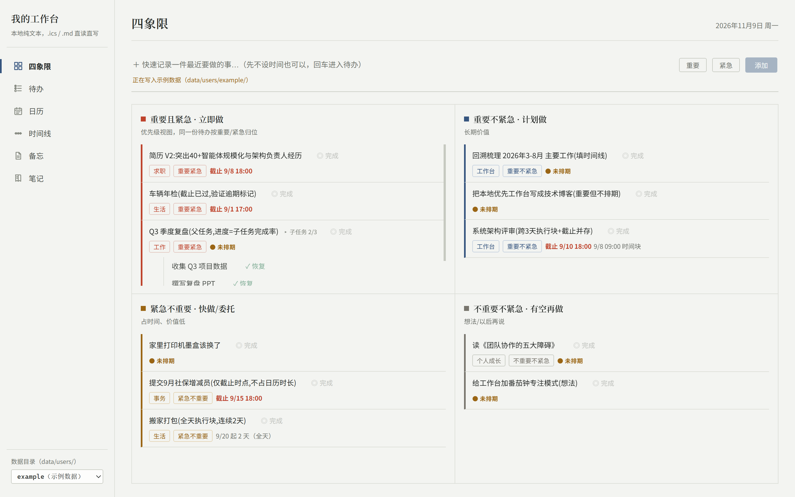
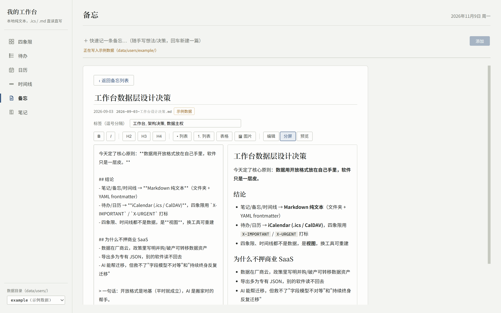

# Personal Workbench (Local-First)

English | [简体中文](README_zh.md)

## Why this workbench

I wanted a better way to manage my own work — todos, schedule, memos and periodic
reviews — without locking years of personal data inside a commercial app's
proprietary format and cloud account. This project holds to two principles:
**data in open standards** (iCalendar RFC 5545, Markdown) and **data stored on
local disk, owned by me** (no database, just plain-text files).

This approach brings two benefits:

1. **Long-lived, maintainable data.** Your data does not depend on the survival of
   any application. Even if this project is abandoned, the `.ics` / `.md` files can
   still be opened with a text editor, Obsidian, Apple/Google Calendar, or any
   CalDAV client — and you can always script your own migration.
2. **LLM-friendly by construction.** Plain text is context. Todos, events and
   memos live in open formats that a model can read and write directly, so AI
   assistance — organizing entries, generating timelines, importing legacy data —
   never has to cross a private API or a database schema.

## What it is

A **local-first, single-user personal workbench**, delivered as a web app with six
views:

- **Quadrant** — Eisenhower priority matrix (important × urgent, computed on the fly as a 2×2 view, not a separate store)
- **Todos** — split into "unscheduled · up next" and "scheduled · upcoming", with parent/child tasks and progress
- **Calendar** — month view: execution blocks ▸ / multi-day spans ▣ / due flags ⚑ / plain events ●
- **Timeline** — monthly reviews (LLM-generated starting from M3)
- **Memos** — Markdown memo list plus detail view
- **Notes** — a real folder tree with Markdown notes, sharing the same editing core as memos

## Screenshots



Quadrant view: the 2×2 important/urgent matrix. The same todo is placed by its
tags on demand — there is no separate quadrant storage.



Memos view: split Markdown editing (source on the left, preview on the right).
Every memo is a plain-text file under `memos/`.

## First principle: data sovereignty

**All business data lives on your local disk in open plain-text formats. There is no database:**

| Data | Format | Location |
| --- | --- | --- |
| Todos + calendar events | iCalendar `.ics` (RFC 5545) | `data/users/{user}/calendar.ics` |
| Memos | Markdown (YAML frontmatter, id prefix `memo-`) | `data/users/{user}/memos/YYYY-MM-DD-title.md` |
| Notes | Markdown (YAML frontmatter, id prefix `note-`) | `data/users/{user}/notes/<folder>/YYYY-MM-DD-title.md` |
| Timelines | Markdown (YAML frontmatter) | `data/users/{user}/timeline/YYYY/MM.md` |

Without this application, the files still open in a text editor, Obsidian,
Apple/Google Calendar, or any CalDAV client. **The software is just a skin**:
edit `calendar.ics` directly in a text editor, refresh the page, and the change
is live.

Current status: **M2 (writable)** — the backend reads and writes `.ics` / `.md`
files, and the frontend supports quick capture and editing.

## Directory layout

```
workbench/
├─ backend/        # FastAPI backend (api → service → datastore, one-way dependencies; API reference in backend/README.md)
├─ frontend/       # Vue 3 + Vite + TS + Tailwind + Pinia
├─ scripts/        # One-command dev.sh launcher and milestone acceptance scripts
├─ data/users/
│  ├─ me/          # Your real data directory
│  └─ example/     # Sample data (demo/testing — safe to experiment with)
├─ data-samples/   # Reference samples + validate.py contract checker
├─ prototype/      # Static prototype (layout baseline)
└─ CLAUDE.md       # Project working rules (data contract, stack, milestones)
```

## Requirements

- Python **3.11+** ([uv](https://github.com/astral-sh/uv) is recommended)
- Node.js **18+**

## Quick start (one command)

On Windows git-bash, from the repository root:

```bash
bash scripts/dev.sh
```

The script starts the FastAPI backend (:8000), then the Vite frontend (:5173),
waits for health checks to pass, and opens your browser automatically. Press
**Ctrl+C** in that terminal to stop both. Logs are written to
`.dev-backend.log` / `.dev-frontend.log` in the repository root.

> Before the first run, create the backend virtual environment (see "Manual
> startup" below); otherwise the script exits with a missing-interpreter error.

Then open **http://127.0.0.1:5173**. A data-source switcher sits at the bottom
of the sidebar:

- `me` — your own data directory (the app defaults to this; empty at first);
- `example` — sample data, a fully populated demo.

To see your own real data, drop `.ics` / `.md` files into
`data/users/me/` (see the table above) and refresh; editing the files
directly in a text editor is reflected on refresh as well.

## Manual startup (for debugging each side separately)

### Backend

```bash
cd backend

# Option A: uv (recommended; a Tsinghua mirror is preconfigured)
uv sync
uv run uvicorn app.main:app --host 127.0.0.1 --port 8000 --reload

# Option B: plain venv
python -m venv .venv
# Windows: .venv\Scripts\activate     Linux/macOS: source .venv/bin/activate
pip install -e .
uvicorn app.main:app --host 127.0.0.1 --port 8000 --reload
```

Health check: `curl http://127.0.0.1:8000/api/health`

Optional environment variables:

| Variable | Purpose | Default |
| --- | --- | --- |
| `WORKBENCH_USER` | Default user directory (when `?user=` is omitted) | `me` |
| `WORKBENCH_DATA` | Data root (still organized as `users/{user}/`) | `data/` inside the repo |

### Frontend

```bash
cd frontend
npm install        # Behind the GFW: add --registry=https://registry.npmmirror.com
npm run dev
```

The dev server proxies `/api/*` to `http://127.0.0.1:8000`, so no CORS setup is
needed.

## HTTP API

The full API reference (endpoints, query parameters, write semantics) is
maintained in **[backend/README.md](backend/README.md)**. It is intentionally
not duplicated here, to keep a single source of truth.

## Testing and validation

```bash
# Backend unit/integration tests: read/write round-trips, Chinese line folding,
# quadrant placement, parent/child progress, cross-month trimming, API coverage,
# atomic writes, the state machine, collection-kernel isolation, legacy-route 404s
cd backend && uv run pytest        # or: python -m pytest inside .venv

# Data-contract validation (field legality, unique UIDs, complete frontmatter)
python data-samples/validate.py data/users/example
```

## Milestones

- **M1 (done)** — read-only backend plus the six-view frontend; your real data is visible.
- **M2 (done)** — write endpoints (CRUD for todos/events/memos/notes) plus quick capture and editing in the UI. Radicale/CalDAV is deferred to M3.
- **M3** — LLM-generated timelines; AI-assisted import of legacy data (TickTick, etc.).
- **M4** — self-hosting, PWA on mobile, optional two-way calendar sync.

For design background see `概要设计-v1.md`, `技术方案-v1.md` and `CLAUDE.md`
(in Chinese).

## License

[MIT](LICENSE)
