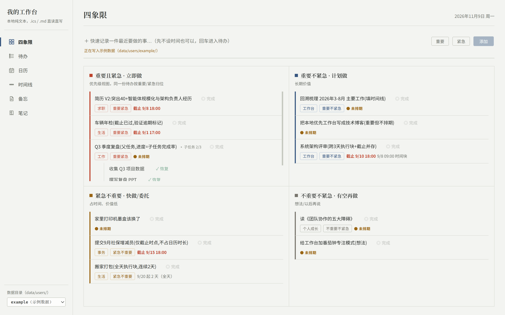
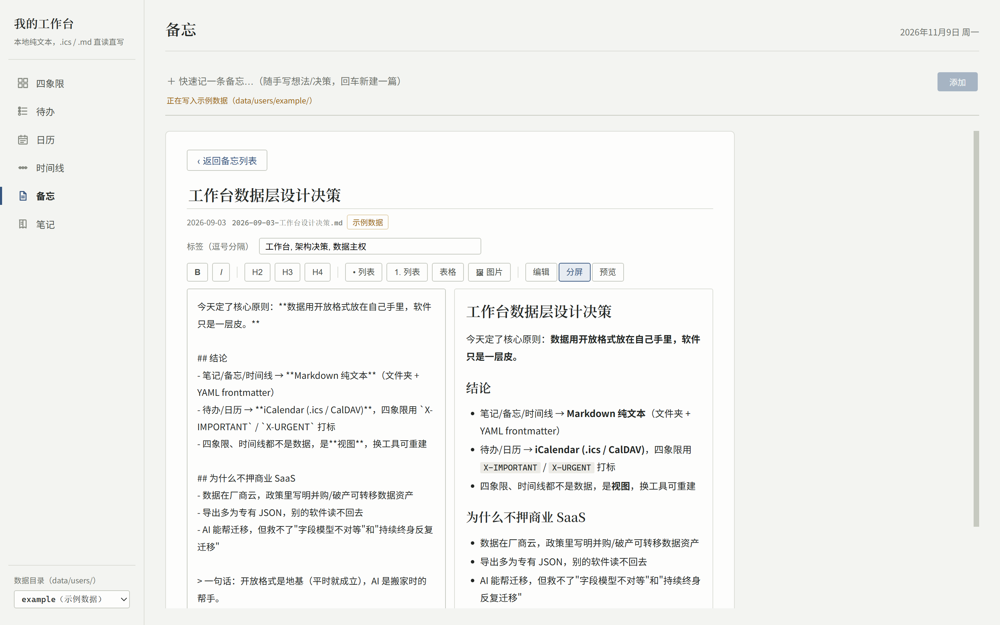

# 个人工作台（Local-First Workbench）

[English](README.md) | 简体中文

## 为什么做这个工作台

我希望能良好地管理自己的事项——待办、日程、备忘与周期性回顾，但不想把长期积累的
个人数据锁进某个商业应用的私有格式和云端账户里。这个工程坚持两条：**数据采用规范
标准**（iCalendar RFC 5545、Markdown），**数据落盘到本地、由自己维护**（没有数据库，
只有纯文本文件）。

这种方式能带来两个好处：

1. **长生命周期的管理与维护** —— 数据不依附于任何应用的存续。哪怕本项目停止维护，
   `.ics` / `.md` 文件依然能用记事本、Obsidian、Apple/Google 日历或任意 CalDAV
   客户端打开，也可以随时自己写脚本迁移。
2. **便于与 LLM 协作** —— 纯文本即上下文。待办、事件、备忘都是模型可以直接读写的
   开放格式，AI 辅助整理、生成时间线、迁入旧数据时，不需要穿越任何私有 API 或
   数据库 schema。

## 是什么

一个**本地优先（local-first）的单用户个人工作台**，Web 应用，包含六个视图：

- **四象限** —— 艾森豪威尔优先级（重要×紧急，2×2 现场计算，不是独立存储）
- **待办** —— 分"未排期 · 最近要做"与"已排期 · 近期"，支持父子任务与进度
- **日历** —— 月视图：执行时间块 ▸ / 跨多天 ▣ / 截止小旗 ⚑ / 普通事件 ●
- **时间线** —— 按月回顾（M3 起由 LLM 生成）
- **备忘** —— Markdown 备忘列表 + 详情
- **笔记** —— 真实文件夹树 + Markdown 笔记，与备忘共用编辑内核

## 界面预览



四象限视图：重要 × 紧急 2×2 矩阵，同一份待办按标签现场归位，不是独立存储。



备忘视图：Markdown 分屏编辑（左源码、右预览），每篇备忘就是 `memos/` 下的一个纯文本文件。

## 🚨 第一性原则：数据主权

**所有业务数据只以开放纯文本格式存在你本地，没有任何数据库：**

| 数据 | 格式 | 位置 |
| --- | --- | --- |
| 待办 + 日历事件 | iCalendar `.ics`（RFC 5545） | `data/users/{用户}/calendar.ics` |
| 备忘 | Markdown（YAML frontmatter，id 前缀 `memo-`） | `data/users/{用户}/memos/YYYY-MM-DD-标题.md` |
| 笔记 | Markdown（YAML frontmatter，id 前缀 `note-`） | `data/users/{用户}/notes/<文件夹>/YYYY-MM-DD-标题.md` |
| 时间线 | Markdown（YAML frontmatter） | `data/users/{用户}/timeline/YYYY/MM.md` |

没有本应用，这些文件也能用记事本、Obsidian、Apple/Google 日历、任意 CalDAV 客户端打开。
**软件只是一层皮**：直接用文本编辑器改 `calendar.ics`，刷新页面即生效。

当前为 **M2（可写）**：后端读写 `.ics`/`.md` 文件，前端支持快速记录与编辑交互。

## 目录结构

```
workbench/
├─ backend/        # FastAPI 后端（api → service → datastore 单向依赖；API 参考见 backend/README.md）
├─ frontend/       # Vue 3 + Vite + TS + Tailwind + Pinia
├─ scripts/        # 一键启动 dev.sh 与各里程碑验收脚本
├─ data/users/
│  ├─ me/          # 你的实际数据目录
│  └─ example/     # 示例数据（演示/测试，可随时改着玩）
├─ data-samples/   # 参考样例 + validate.py 契约校验器
├─ prototype/      # 静态原型（布局基准）
└─ CLAUDE.md       # 项目工作守则（数据契约、技术栈、里程碑）
```

## 环境要求

- Python **3.11+**（推荐用 [uv](https://github.com/astral-sh/uv) 管理）
- Node.js **18+**

## 快速开始（一键启动）

Windows git-bash，仓库根目录执行：

```bash
bash scripts/dev.sh
```

脚本一次完成：起 FastAPI 后端（:8000）→ 起 Vite 前端（:5173）→ 探活通过后自动打开
浏览器。在该终端按 **Ctrl+C** 同时停掉前后端。日志落在仓库根的
`.dev-backend.log` / `.dev-frontend.log`。

> 首次运行前需准备好后端虚拟环境（见下节"手动启动"），否则脚本会报找不到解释器。

浏览器打开 **http://127.0.0.1:5173**，侧栏底部可切换数据源：

- `me` —— 你自己的数据目录（应用默认使用，初始为空态）；
- `example` —— 示例数据，切过去即可看到完整效果。

想看到自己的真实数据：把 `.ics` / `.md` 文件放进 `data/users/me/`
（结构见上表），刷新页面即可；直接用文本编辑器改文件，刷新即变。

## 手动启动（分别调试前后端时用）

### 后端

```bash
cd backend

# 方式一：uv（推荐，已配清华镜像源）
uv sync
uv run uvicorn app.main:app --host 127.0.0.1 --port 8000 --reload

# 方式二：原生 venv
python -m venv .venv
# Windows: .venv\Scripts\activate   Linux/macOS: source .venv/bin/activate
pip install -e .
uvicorn app.main:app --host 127.0.0.1 --port 8000 --reload
```

健康检查：`curl http://127.0.0.1:8000/api/health`

可选环境变量：

| 变量 | 作用 | 默认 |
| --- | --- | --- |
| `WORKBENCH_USER` | 默认用户目录（未传 `?user=` 时用） | `me` |
| `WORKBENCH_DATA` | 数据总根（仍按 `users/{user}/` 组织） | 仓库内 `data/` |

### 前端

```bash
cd frontend
npm install        # 国内网络可加 --registry=https://registry.npmmirror.com
npm run dev
```

开发服务器已配置代理：前端对 `/api/*` 的请求自动转发到 `http://127.0.0.1:8000`，无需处理跨域。

## HTTP API

API 参考（全部端点、查询参数、写操作语义）统一在 **[backend/README.md](backend/README.md)**
维护，根 README 不再重复，避免两份文档漂移。

## 测试与校验

```bash
# 后端单元/集成测试：读写往返、中文折行、象限归位、父子进度、跨月裁剪、
# API、原子写、状态机、集合内核隔离、旧路由 404
cd backend && uv run pytest        # 或 .venv 下：python -m pytest

# 数据契约校验（字段合法性、UID 唯一、frontmatter 完整）
python data-samples/validate.py data/users/example
```

## 里程碑

- **M1（已完成）**：只读后端 + 六视图前端，能看到自己的真实数据。
- **M2（已完成）**：写接口（待办/事件/备忘/笔记增删改）+ 前端快速记录与编辑交互。Radicale/CalDAV 推迟到 M3。
- **M3**：时间线 LLM 生成；旧数据（TickTick 等）AI 迁入。
- **M4**：自托管 + PWA 手机端 + 可选日历双向同步。

更多设计背景见 `概要设计-v1.md`、`技术方案-v1.md`、`CLAUDE.md`。

## 许可证

[MIT](LICENSE)
